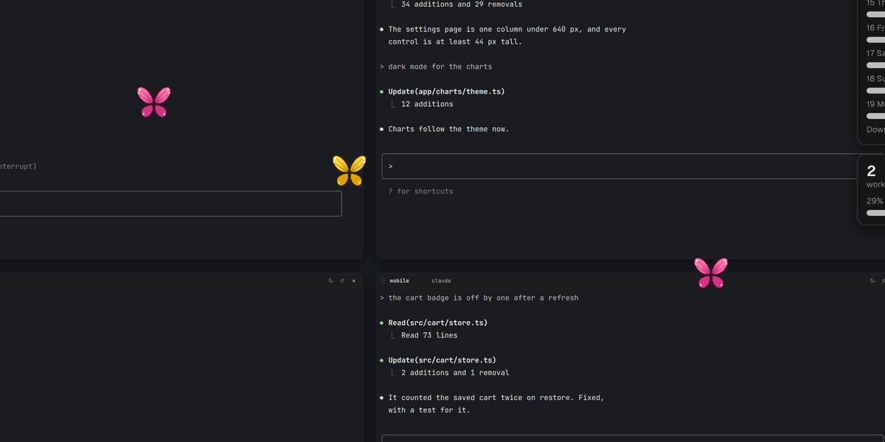

# Butterflies

A widget that flies. A butterfly flutters over your screen with no card around it: wings beating,
on a wandering, curving path. Now and then it lands, folds its wings and rests for a few seconds
with slow, lazy flaps, then takes off again. Place a few; each picks a colour of its own.



- **An agent gets to work, or finishes a turn:** a resting butterfly scatters, fast, away from
  where it sat, and a flying one dashes off.
- **Click it:** it scatters too.

```bash
hive plugins install @dip497/butterflies   # then add it from the toolbar's Add menu
hive ctl plugin open @dip497/butterflies        # or let an agent place it (once per butterfly)
hive ctl plugin call @dip497/butterflies scatter       # send it off; answers its colour and what it is doing
```

Options: **colour**: orange, blue, yellow, pink or green; "Its own" (the default) keeps the colour
it picked when it was placed. It asks for no permissions: it hears the agents' states and turns
through `hive.hm`, which needs none. No sound.

Under reduced motion it holds still on one frame and does not move. That needs a Hivemind that
tells widgets about reduced motion (`hive.reducedMotion`); on an older app it keeps flying.

`butterflies.svg` is one sprite sheet, 8 frames of 64 px a row: for each of the five colours, a row
flying (a full wing beat) and a row resting (slow flaps). It is original art, drawn in code, under
this repository's MIT licence.

## How it was made

Built by a coding agent (Claude) from the widget contract (`hive plugins new widget`'s brief, `hive.d.ts`
and the [Widgets guide](https://github.com/dip497/hivemind/blob/main/site/src/content/docs/guide/widgets.md)), then checked in the app
over a board of working agents. The sprite sheet was drawn by a short script, shape by shape. Its
behaviour test is `tests/widgets.test.ts` in this repository, which runs `widget.js` with the same
worker prelude the app uses.
